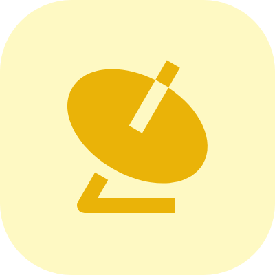
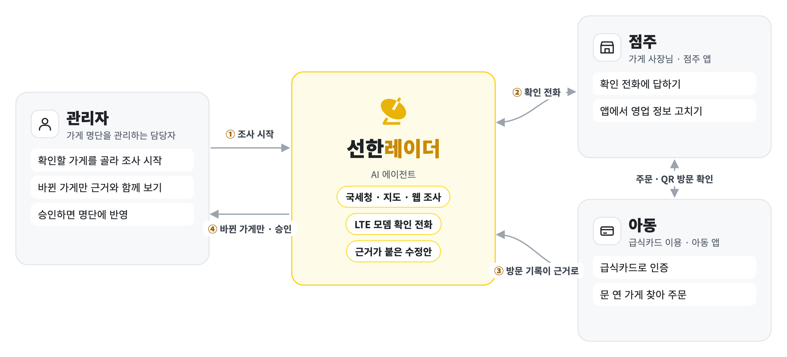
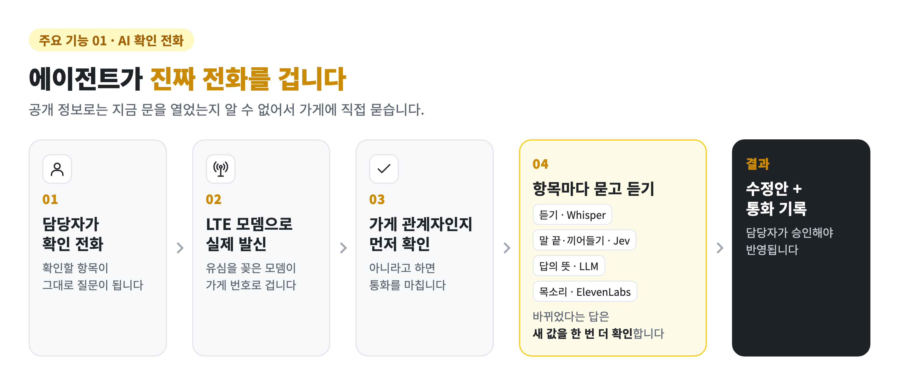
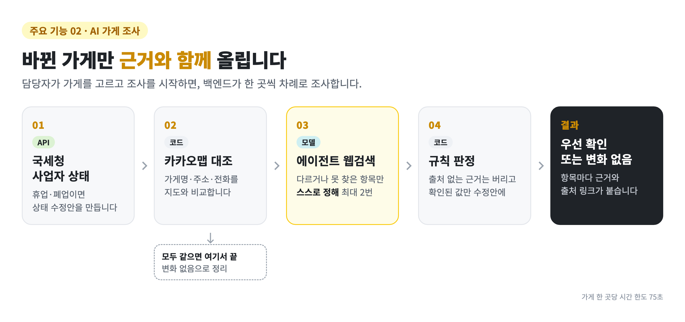
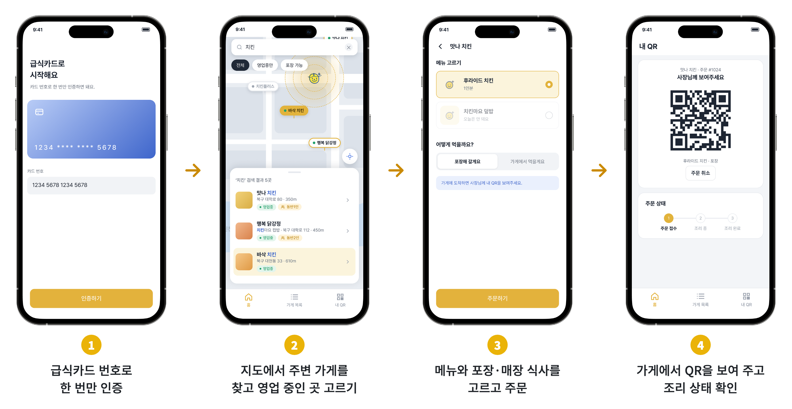
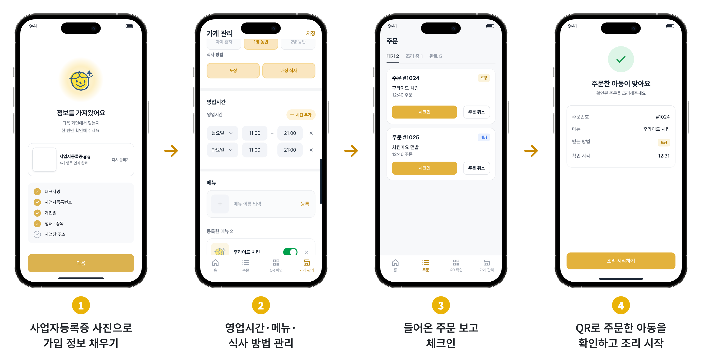
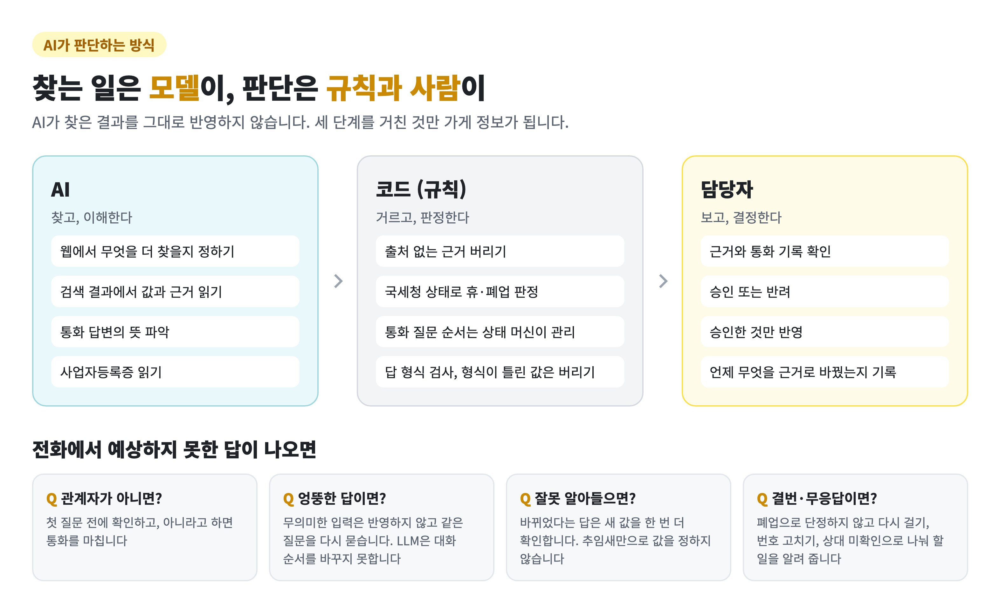
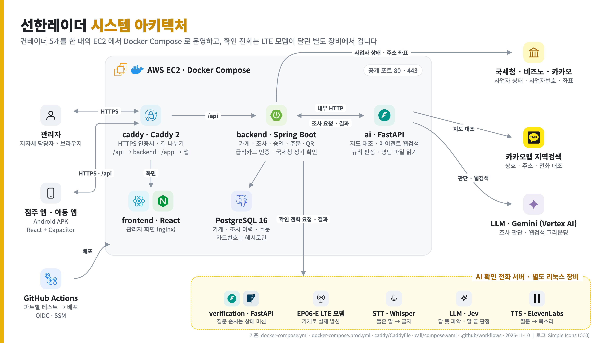
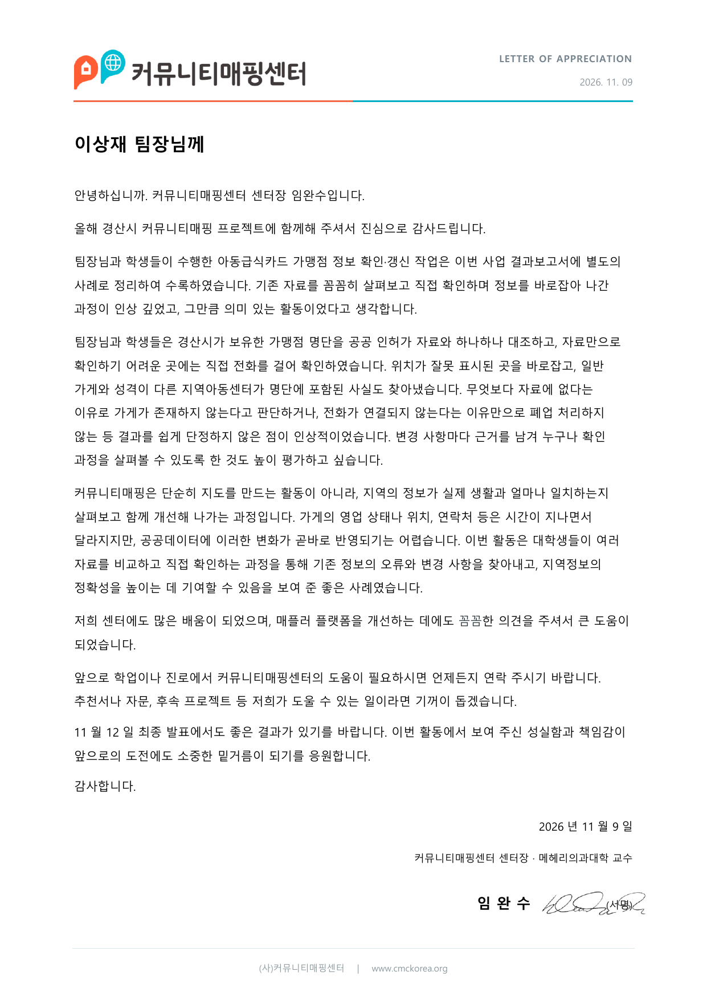

<div align="center">



<h1>선한레이더</h1>

https://github.com/user-attachments/assets/d4581e1e-560c-4812-a4ec-76f607345c48

<h3>결식아동 지원 가게가 아직 문을 열었는지, 정보가 바뀌지 않았는지</h3>

에이전트가 조사하고 가게에 직접 전화해 확인한 뒤, 담당자에게는 바뀐 것만 올립니다.

<a href="https://goodradar.duckdns.org"></a>&nbsp;<a href="https://github.com/kakaotechcampus-4/ktc4-kyungpook-6/releases/tag/app-1.0.0-demo"></a>&nbsp;<a href="#실제-통화-들어-보기"></a>

<a href="#트러블슈팅"></a>&nbsp;<a href="#기술-멘토링"></a>&nbsp;<a href="#로컬에서-시작하기"></a>

</div>

---

## 서비스 소개

결식아동은 급식카드를 받는 가게나 선한영향력가게처럼 결식아동을 돕는 가게에서 밥을 먹습니다. 이 가게 명단을 관리하는 일은 아직 담당자가 하나하나 찾아보고 전화하는 데 기대고 있습니다. 경산시 급식카드 가게 명단에서 38곳에 직접 전화해 보니 18곳이 결번이었습니다([경산시 커뮤니티매핑 결과보고서](./docs/외부활동/경산시_커뮤니티매핑_결과보고서_발췌.pdf)). 문을 닫은 가게가 명단과 지도에 그대로 남아 있었습니다.

선한레이더는 AI 에이전트가 가게 정보를 조사하고, 필요하면 가게에 직접 전화해 확인합니다. 담당자는 바뀐 가게만 근거와 함께 보고 승인합니다.

[](./docs/images/readme/service-flow.png)

## 실제 통화 들어 보기

에이전트가 LTE 모뎀으로 실제 전화를 걸어 나눈 시연 통화입니다. 백엔드가 통화 서버에 확인할 항목을 보내면, 통화 서버가 가게에 전화해 묻고 답을 돌려줍니다.

### ① 바뀐 정보를 확인하는 전화

조사에서 상호명이 바뀐 것 같다는 신호가 잡힌 가게에, 새 상호명이 맞는지 묻습니다. 가게가 맞다고 답하자 새 상호명을 답으로 돌려줍니다. 연결부터 끝까지 37초 걸렸습니다.

#### 1. 백엔드가 확인할 항목을 보냅니다

 `/v1/verification-call`

**요청**

```json
{
    "target": {
        "storeLocation": "대구광역시 북구 대학로 80",
        "storeName": "프롬프트 카페",
        "phoneNumber": "010-0000-0000"
    },
    "questions": [
        {
            "id": "q1",
            "type": "VALUE_CONFIRMATION",
            "field": "storeName",
            "naturalField": "상호명",
            "currentValue": "프롬프트 카페",
            "expectedValue": "프롬프트 베이커리"
        }
    ]
}
```

**응답**

```json
{
    "verificationId": "xxxxxxxx-xxxx-xxxx-xxxx-xxxxxxxxxxxx"
}
```

#### 2. 에이전트가 가게에 전화합니다

https://github.com/user-attachments/assets/4f577b93-edc5-41a6-99ff-e4a5e6c70425

#### 3. 들은 답을 결과로 돌려받습니다

 `/v1/verification-call/xxxxxxxx-xxxx-xxxx-xxxx-xxxxxxxxxxxx`

```json
{
    "verificationId": "xxxxxxxx-xxxx-xxxx-xxxx-xxxxxxxxxxxx",
    "status": "COMPLETED",
    "answers": [
        {
            "questionId": "q1",
            "field": "storeName",
            "value": "프롬프트 베이커리"
        }
    ],
    "createdAt": "2026-11-10T18:37:28.349928+00:00",
    "startedAt": "2026-11-10T18:37:30.469015+00:00",
    "connectedAt": "2026-11-10T18:37:40.568922+00:00",
    "endedAt": "2026-11-10T18:38:17.682458+00:00",
    "failureReason": null
}
```

### ② 90일 넘게 확인하지 않은 가게에 거는 전화

확인한 지 오래된 가게에는 짚을 값 없이, 등록된 상호명과 영업 여부가 지금도 그대로인지 하나씩 묻습니다. 둘 다 그대로라는 답을 돌려줍니다. 연결부터 끝까지 47초 걸렸습니다.

#### 1. 백엔드가 확인할 항목을 보냅니다

 `/v1/verification-call`

**요청**

```json
{
    "target": {
        "storeLocation": "대구광역시 북구 대학로 80",
        "storeName": "프롬프트 카페",
        "phoneNumber": "010-0000-0000"
    },
    "questions": [
        {
            "id": "q1",
            "type": "CHANGE_DETECTION",
            "fields": [
                {
                    "field": "storeName",
                    "naturalField": "상호명",
                    "currentValue": "프롬프트 카페"
                },
                {
                    "field": "isOpen",
                    "naturalField": "영업 여부",
                    "currentValue": true
                }
            ]
        }
    ]
}
```

**응답**

```json
{
    "verificationId": "xxxxxxxx-xxxx-xxxx-xxxx-xxxxxxxxxxxx"
}
```

#### 2. 에이전트가 가게에 전화합니다

https://github.com/user-attachments/assets/a3106e2c-ee03-4d85-8f72-5cc16f91b427

#### 3. 들은 답을 결과로 돌려받습니다

 `/v1/verification-call/xxxxxxxx-xxxx-xxxx-xxxx-xxxxxxxxxxxx`

```json
{
    "verificationId": "xxxxxxxx-xxxx-xxxx-xxxx-xxxxxxxxxxxx",
    "status": "COMPLETED",
    "answers": [
        {
            "questionId": "q1",
            "field": "storeName",
            "value": "프롬프트 카페"
        },
        {
            "questionId": "q1",
            "field": "isOpen",
            "value": true
        }
    ],
    "createdAt": "2026-11-10T19:25:15.875312+00:00",
    "startedAt": "2026-11-10T19:25:18.017049+00:00",
    "connectedAt": "2026-11-10T19:25:40.174306+00:00",
    "endedAt": "2026-11-10T19:26:26.904355+00:00",
    "failureReason": null
}
```

## 주요 기능

### 01. AI 확인 전화

공개 정보는 가게가 지금 문을 열었는지까지 알려 주지 않습니다. 그래서 에이전트가 가게에 직접 전화합니다. 유심을 꽂은 LTE 모뎀으로 실제 번호에 발신합니다.

[](./docs/images/readme/feature-call.png)

### 02. AI 가게 조사

[](./docs/images/readme/feature-investigation.png)

### 03. 아동 앱

급식카드만 있으면 가까운 가게를 찾아 주문하고, 가게에서는 QR 하나로 확인합니다.

[](./docs/images/readme/app-child.png)

### 04. 점주 앱

사업자등록증 사진으로 가입하고, 영업 정보를 고치고, 들어온 주문을 받아 QR로 방문을 확인합니다.

[](./docs/images/readme/app-owner.png)

## AI가 판단하는 방식

[](./docs/images/readme/ai-roles.png)

자세한 대화 규칙은 [통화 서버 문서](./call/README.md), 실패 사유와 할 일은 [확인 전화 문서](./docs/확인_전화.md)에 있습니다.

### 측정

**조사**: 실제 영업 중인 가게에 한 항목씩 일부러 틀린 값을 넣고, 에이전트가 찾아내는지 쟀습니다.

| 비교 | 결과 |
| --- | --- |
| 지도를 먼저 보게 함 | 틀린 값 약 34곳 중 **22곳**을 잡음 (웹검색만 하면 10곳) |
| 다음 검색을 AI가 정하게 함 | 맞는 값까지 고친 곳이 규칙 8곳 → AI **10~11곳**, 틀린 값 0 |
| 맞는 가게를 건드리지 않음 | 대조군 24곳 중 16~20곳, 나머지는 담당자 승인 단계에서 걸러짐 |

**확인 전화**: 실제로 건 통화에서 쟀습니다.

| 통화 | 걸린 시간 | 주고받은 횟수 |
| --- | --- | --- |
| 세 항목을 끝까지 확인 | 79초 | 4번 |

모델별 비교와 측정 조건은 [2차 조사 문서](./ai/docs/2차_조사.md#측정)에 있습니다.

### 의도와 달랐던 결과와 바꾼 것

| 해 본 것 | 결과 | 그래서 |
| --- | --- | --- |
| 웹검색으로 폐업 찾기 | 폐업한 30곳 중 신호가 잡힌 곳 1곳 | 폐업은 국세청 사업자 상태로만 판정 |
| 검색 결과의 전화번호 대조 | 상당수가 0507 안심번호라 멀쩡한 가게도 "다름"으로 나옴 | 안심번호는 대조에서 제외 |
| 블로그를 읽는 조사 에이전트 | 잡은 곳 18 → 17, 고친 값 9 → 9, 가게당 25초 증가 | 효과 없이 느려져서 넣지 않음 |

## 서비스 구성

[](./docs/images/architecture/architecture.png)

## 기술 스택

### Frontend · App

<p>


</p>

### Backend

<p>


</p>

### AI

<p>


</p>

### Call

<p>


</p>

### Infra

<p>


</p>

### Collaboration

<p>


</p>

## 테스트와 배포

- TADD(테스트 + AI 주도 개발)로 개발했습니다. 구현할 내용을 AI에게 설명해 **테스트를 먼저 쓰고**, 그 테스트를 통과하는 코드를 작성한 뒤, 기존 테스트 전체를 다시 돌려 회귀를 확인합니다. [TADD 문서](./docs/TADD_개발.md)
- 테스트 파일 약 200개(backend 147 · ai 19 · call 4 · frontend 13 · app 17). PR마다 바뀐 파트의 테스트를 GitHub Actions에서 돌립니다.
- `main`에 머지되면 GitHub Actions가 OIDC로 AWS 권한을 받아 SSM으로 EC2에 배포합니다. 배포 키를 저장소에 두지 않습니다.

## 트러블슈팅

개발하면서 막혔던 문제와 원인, 해결 과정을 정리했습니다.

| 문제 | 파트 | 핵심 |
| --- | --- | --- |
| [[제목 1]](./docs/트러블슈팅/01.md) | [__] | [__] |
| [로컬에선 되는데 배포본에서만 조사 저장이 실패한 이유](./docs/트러블슈팅/02.md) | Back · Infra | `ddl-auto`는 이미 있는 CHECK 제약을 고치지 않는다 → Flyway 도입, 코드와 DB가 어긋나면 서버가 뜨지 않게 |
| [[제목 3]](./docs/트러블슈팅/03.md) | [__] | [__] |

## 기술 멘토링

네 번의 기술 멘토링에서 나온 이야기, 정한 방향, 그 뒤에 바뀐 것을 회차별로 정리했습니다.

| 회차 | 나온 이야기 | 바뀐 것 |
| --- | --- | --- |
| [1회차 · 4주차](./docs/기술멘토링/01_4주차.md) | 이 서비스를 써야 하는 이유, 동작을 증명하는 방법 | 기술로 푸는 방향 선택, 조사 이력과 60곳 측정 |
| [2회차 · 7주차](./docs/기술멘토링/02_7주차.md) | 백엔드와 AI의 연결 방향, 문서와 코드의 기준, 앱 프레임워크 | 백엔드가 AI를 호출, 스펙 선공개 규칙, React + Capacitor 앱 |
| [3회차 · 11주차](./docs/기술멘토링/03_11주차.md) | 약관 안에서 조사가 에이전트답지 않다는 고민 | 가게에 직접 전화하는 에이전트로 방향 전환, 사업자등록증 읽기 |
| [4회차 · 최종 주](./docs/기술멘토링/04_최종.md) | 발표 리허설, 제출 문서 | 전화 중심 발표, README와 멘토링 기록 |

마지막 멘토링에서 멘토님은 기억에 남는 PR로 8주차 [#58](https://github.com/kakaotechcampus-4/ktc4-kyungpook-6/pull/58)을 꼽았습니다. 2차 조사를 비동기로 돌리는 방법으로 Spring Batch가 먼저 나왔지만, PR 댓글로 다시 짚어 보며 이미 있던 Job 엔티티로 충분하다는 결론을 냈습니다. 멘토님은 이를 새 프레임워크를 들이는 오버 스펙을 대화로 막은 사례라고 하셨습니다. ([2회차 기록](./docs/기술멘토링/02_7주차.md#pr-58-spring-batch-대신-job))

## 팀

카카오테크 캠퍼스 4기 · 경북대 6팀 프롬프트

<table>
<tr>
<td align="center" width="16%"><a href="https://github.com/softkleenex"></a></td>
<td align="center" width="16%"><a href="https://github.com/MOJAN3543"></a></td>
<td align="center" width="16%"><a href="https://github.com/hellowo1"></a></td>
<td align="center" width="16%"><a href="https://github.com/HYH1945"></a></td>
<td align="center" width="16%"><a href="https://github.com/jungi0531"></a></td>
<td align="center" width="16%"><a href="https://github.com/podkeke"></a></td>
</tr>
<tr>
<td align="center"><b>이상재</b></td>
<td align="center"><b>심준성</b></td>
<td align="center"><b>이제민</b></td>
<td align="center"><b>황영하</b></td>
<td align="center"><b>홍준기</b></td>
<td align="center"><b>노은서</b></td>
</tr>
<tr>
<td align="center"><a href="https://github.com/softkleenex">@softkleenex</a></td>
<td align="center"><a href="https://github.com/MOJAN3543">@MOJAN3543</a></td>
<td align="center"><a href="https://github.com/hellowo1">@hellowo1</a></td>
<td align="center"><a href="https://github.com/HYH1945">@HYH1945</a></td>
<td align="center"><a href="https://github.com/jungi0531">@jungi0531</a></td>
<td align="center"><a href="https://github.com/podkeke">@podkeke</a></td>
</tr>
<tr>
<td align="center">팀장 (PM)</td>
<td align="center">FE 리드</td>
<td align="center">BE 리드</td>
<td align="center">AI 리드</td>
<td align="center">플래너</td>
<td align="center">메이커</td>
</tr>
</table>

## 문서

| 문서 | 내용 |
| --- | --- |
| [API 문서 (Swagger)](https://goodradar.duckdns.org/swagger-ui/index.html) | 배포 서버의 API 요청·응답 명세 |
| [AI 연동 명세](./ai/docs/백엔드_연동.md) | AI 서버와 백엔드가 주고받는 형식, 계약 테스트 |
| [2차 조사](./ai/docs/2차_조사.md) · [웹검색 폴백](./ai/docs/웹검색_폴백.md) | 조사 흐름, 측정, 실패 분석과 고친 것 |
| [확인 전화](./docs/확인_전화.md) · [통화 서버](./call/README.md) | 전화 흐름, 대화 규칙, 실패 사유 |
| [테스트 파이프라인](./docs/TADD_개발.md) | 파트별 테스트 방식과 CI/CD |
| [깃 협업 규칙](./docs/깃_협업_규칙.md) · [백엔드 코딩 컨벤션](./backend/docs/백엔드_코딩_컨벤션_가이드.md) · [에러 처리](./docs/에러_처리_가이드.md) · [도메인 용어집](./docs/도메인_용어집.md) | 팀 컨벤션 |
| [주간 코드 리뷰 PR](https://github.com/kakaotechcampus-4/ktc4-kyungpook-6/pulls?q=is%3Apr+base%3Amain) | 매주 멘토에게 리뷰받은 `develop → main` PR |
| [경산시 커뮤니티매핑 결과보고서 (발췌)](./docs/외부활동/경산시_커뮤니티매핑_결과보고서_발췌.pdf) | 경산시 아동급식카드 가맹점 232건 확인 사례, (사)커뮤니티매핑센터 |
| [커뮤니티매핑센터 감사장](./docs/외부활동/커뮤니티매핑센터_감사장.png) | 경산시 작업에 대한 (사)커뮤니티매핑센터의 감사장 (2026.11.09) |

<p align="center">

<br><sub>(사)커뮤니티매핑센터 감사장, 2026.11.09</sub>
</p>

## 로컬에서 시작하기

관리자 화면, 백엔드, AI 조사 서버, DB가 Docker Compose 한 번으로 뜹니다.

### 1. 준비물

- Git, Docker Desktop (Docker Compose 포함)
- 파트를 따로 띄울 때만: Java 21 + Gradle, Python 3.12 + uv, Node.js

### 2. 내려받고 환경 변수 만들기

```bash
git clone https://github.com/kakaotechcampus-4/ktc4-kyungpook-6.git
cd ktc4-kyungpook-6
cp .env.example .env
```

DB 값은 예시 그대로 써도 됩니다. 나머지는 쓰려는 기능에 맞춰 채웁니다.

| 채울 값 | 쓰는 곳 | 비워 두면 |
| --- | --- | --- |
| `ADMIN_EMAIL` · `ADMIN_PASSWORD` | 관리자 로그인 | 관리자 계정이 만들어지지 않습니다 |
| `JWT_SECRET` (32바이트 이상) | 로그인 토큰 | 임시 키로 떠서, 재시작하면 로그인이 풀립니다 |
| `CARD_HASH_SECRET` (32바이트 이상) | 아동 급식카드 인증 | 카드 인증이 503으로 응답합니다 |
| `NTS_SERVICE_KEY` · `BIZNO_API_KEY` | 국세청 사업자 상태, 사업자번호 조회 | 해당 조회를 할 수 없습니다 |
| `GOOGLE_CLOUD_PROJECT` · `VERTEX_KEY_PATH` | AI 조사 | 조사가 503으로 응답합니다 |
| `KAKAO_REST_API_KEY` | 지도 대조, 주소 → 좌표 | 지도 대조 없이 웹검색만 합니다 |
| `VERIFICATION_API_BASE_URL` · `VERIFICATION_API_KEY` | 확인 전화 | 전화를 걸 수 없습니다 |

각 값의 자세한 설명은 `.env.example` 의 주석에 있습니다.

### 3. 실행

```bash
docker compose up -d --build
```

| 무엇 | 주소 |
| --- | --- |
| 관리자 화면 | http://localhost:3000 |
| API 문서 (Swagger) | http://localhost:8080/swagger-ui/index.html |

처음에는 DB에 가게가 없습니다. 관리자로 로그인한 뒤 Swagger의 `POST /api/admin/stores/imports` 로 가게 자료(JSON)를 넣습니다.

### 4. 점주 앱 · 아동 앱

```bash
cd app
cp .env.example .env     # VITE_KAKAO_JS_KEY 를 넣어야 지도가 뜹니다
npm ci
npm run dev
```

브라우저로 열면 점주와 아동 중 역할을 고르는 화면부터 나옵니다. Android APK는 `app/scripts/build-apk.sh <백엔드 주소>` 로 만듭니다(Android SDK 필요).

### 5. 확인 전화 서버

LTE 모뎀(EP06-E)이 USB로 연결된 Linux 장비에서만 돌아갑니다. 설치와 실행은 [통화 서버 문서](./call/README.md)를 보세요.

### 6. 테스트

각 파트는 자기 폴더에서 돌립니다. CI(`.github/workflows/test.yml`)도 같은 스크립트를 씁니다.

| 파트 | 준비 | 테스트 |
| --- | --- | --- |
| `backend/` | `brew install gradle` (Java 21) | `./scripts/test.sh` |
| `ai/` | `uv sync` | `./scripts/test.sh` |
| `call/` | `pip install -r requirements.txt` | `./scripts/test.sh` |
| `frontend/` | `npm ci` | `./scripts/test.sh` |
| `app/` | `npm ci` | `npm test` |

백엔드는 Gradle wrapper 를 쓰지 않습니다. 설치한 Gradle 로 빌드합니다.

AI 서버만 따로 띄울 때는 `cd ai && uv run uvicorn src.server.main:app --reload --port 8000` 을 씁니다.

<details>
<summary><b>저장소 구조</b></summary>

```
backend/    Spring Boot · Java 21     가게·조사·인증·QR 체크인 API
ai/         FastAPI · Python          가게 정보 2차 조사 (웹검색·카카오맵·국세청)
frontend/   React · Vite              관리자 웹 (가게 목록, 조사 결과 검토)
app/        Capacitor · React         점주 앱 · 아동 앱 (한 코드에서 APK 둘)
docs/       팀 공통 문서              용어집, 깃·Jira 규칙, 에러 규격
scripts/    deploy.sh                 compose 파일을 묶어 배포
.github/    워크플로                  테스트, 배포, 멘토 자동 배정, 디스코드 알림
```

</details>

<details>
<summary><b>배포 설정 (팀 내부용)</b></summary>

compose 파일이 셋입니다. **base 위에 환경별 오버라이드를 얹는 구조**라 직접 부르지 말고
`scripts/deploy.sh` 를 쓰세요.

```
docker-compose.yml        base       — 모든 환경 공통
docker-compose.dev.yml    dev 전용   — 인증·외부 API 환경변수, DB·AI 포트 공개
docker-compose.prod.yml   prod 전용
```

```bash
scripts/deploy.sh dev up -d --build
```

`.env` 는 **각 서버에 둡니다**(git 에 올리지 않습니다). compose 는 그 파일을 `${...}` 치환에만
쓰고, 오버라이드의 `environment:` 에 적은 것만 컨테이너에 들어갑니다.

dev 서버에서만 쓰는 값은 `.env.development` 에 따로 둡니다(`.env.development.example` 참고).
`scripts/deploy.sh dev` 가 `.env` 위에 얹어 읽고, 같은 키는 `.env.development` 가 이깁니다.
파일이 없으면 `.env` 만 읽습니다.

| 값 | 설명 |
|---|---|
| `POSTGRES_PORT` | DB 를 바깥에 여는 포트. 비어 있으면 dev 배포가 멈춥니다 |
| `AI_PORT` | AI 서버를 바깥에 여는 포트(기본 8000). AI 포트를 열기 때문에 dev 는 `.env` 의 `INTERNAL_API_KEY` 가 비어 있으면 배포가 멈춥니다 |
| `AI_BASE_URL` | 백엔드가 부를 AI 주소(기본 `http://ai:8000`). base·prod 는 이 주소로 고정이라 dev 에서만 바꿀 수 있습니다 |

백엔드 주소는 **쓰임이 달라 키가 둘**입니다. 한 키를 두 뜻으로 쓰다가 10주차 멘토 리뷰에서 지적받아 갈랐습니다.

| 값 | 누가 읽나 | 언제 박히나 |
|---|---|---|
| `PUBLIC_BACKEND_URL` | 브라우저 — 공개망 주소입니다 | frontend 를 빌드할 때 |
| `BACKEND_BASE_URL` | AI 컨테이너 — dev 에서만 바꿉니다 | 컨테이너가 뜰 때 |

`PUBLIC_` 접두사는 "여기 들어간 값은 전 세계가 본다" 는 뜻입니다. 내부망 주소를 넣지 마세요.

서버 `.env` 에 `PUBLIC_BACKEND_URL` 이 없으면 옛 키(`BACKEND_BASE_URL`)로 떨어집니다 — 서버에 키를 넣기
전에 머지돼도 화면이 죽지 않게 둔 폴백입니다. 서버 `.env` 에 키가 들어가면 `docker-compose.yml` 에서 그
폴백을 지우세요.

⚠️ dev 의 AI 컨테이너는 **지금 공개 주소로 백엔드를 부릅니다**(서버 `.env` 에 들어 있는 값이 그것입니다).
내부망 `http://backend:8080` 으로 돌리는 쪽이 맞지만, 호출 경로가 달라지므로 배포본에서 조사가 도는지
확인한 뒤에 바꿉니다. `http://localhost:8080` 은 AI 컨테이너 안에서 자기 자신을 가리키니 넣지 마세요.

**AI 조사에 필요한 값**

조사는 **Vertex AI** 로 돕니다. 키가 없으면 **배포는 성공하고 화면도 뜨는데 조사만 503** 이라 티가
안 납니다(`ai/src/server/main.py` 가 `GOOGLE_CLOUD_PROJECT` 가 없으면 조사기를 안 꽂습니다).

Vertex 는 API 키가 아니라 **서비스 계정 JSON(ADC)** 으로 인증합니다. 배포에서는 저장소 시크릿에서
받아 붙입니다 — **서버 `.env` 를 고치지 않습니다.**

```
GitHub Secrets (GCP_SA_KEY)  →  deploy-dev.yml 이 ~/.ktc4/vertex.json 으로 씀
                             →  VERTEX_KEY_PATH  →  컨테이너 /run/secrets/vertex.json
```

| 이름 | 종류 | 없으면 |
|---|---|---|
| `GCP_SA_KEY` · `GCP_PROJECT_ID` | Secret | 조사가 503 |
| `KAKAO_REST_API_KEY` | Secret | 지도 확인 없이 웹검색만 |
| `NAVER_CLIENT_ID` · `NAVER_CLIENT_SECRET` | Secret | 네이버 대조 불가 |
| `AGENT_API_KEY` | Secret | 판단 모델이 Vertex 로 떨어집니다 |
| `AI_NAVER_LOCAL_ENABLED` · `AI_KAKAO_COMPARE_ENABLED` · `AI_AGENT_ENABLED` · `AI_AGENT_MODEL` | Variable | 전부 꺼짐 |

지도 대조를 막던 상호 자르기 버그는 `3e541c6`(2026-10-09)에서 고쳐졌습니다 —
`"대구왕갈비본점"` 은 그대로 두고 `"크라운호프대구수성못점"` 의 지점명 앞 지역어만 뗍니다.

⚠️ **네이버는 켜지 않습니다.** 장소 페이지 자동 접근이 막혀 있고 약관상 저장도 안 됩니다
(12곳 모두 차단 — `#120` 측정). 카카오만 쓰되 **실시간 비교 후 폐기**합니다.

배포는 `main`·`develop` 푸시에 `.github/workflows/deploy-main.yml`·`deploy-dev.yml` 이 돕니다.
**main 쪽은 `workflow_dispatch` 로 손으로도 돌릴 수 있습니다** — 그게 없으면 주간 멘토 리뷰 PR 이
머지될 때만 돌아서, 배포를 고쳐도 다음 주까지 시험할 방법이 없었습니다.

</details>

<details>
<summary><b>브랜치와 PR 규칙</b></summary>

- 브랜치 이름은 `PROMPT-{번호}-{파트}-{설명}` — **이슈 키가 있어야 Jira 상태가 자동으로 움직입니다**
- 개인 작업은 `develop` 으로, 주간 멘토 리뷰는 `develop → main` 으로 올립니다

자세한 규칙은 [`docs/깃_협업_규칙.md`](docs/깃_협업_규칙.md) 와
[`docs/Jira_사용_가이드.md`](docs/Jira_사용_가이드.md) 에 있습니다.

</details>
