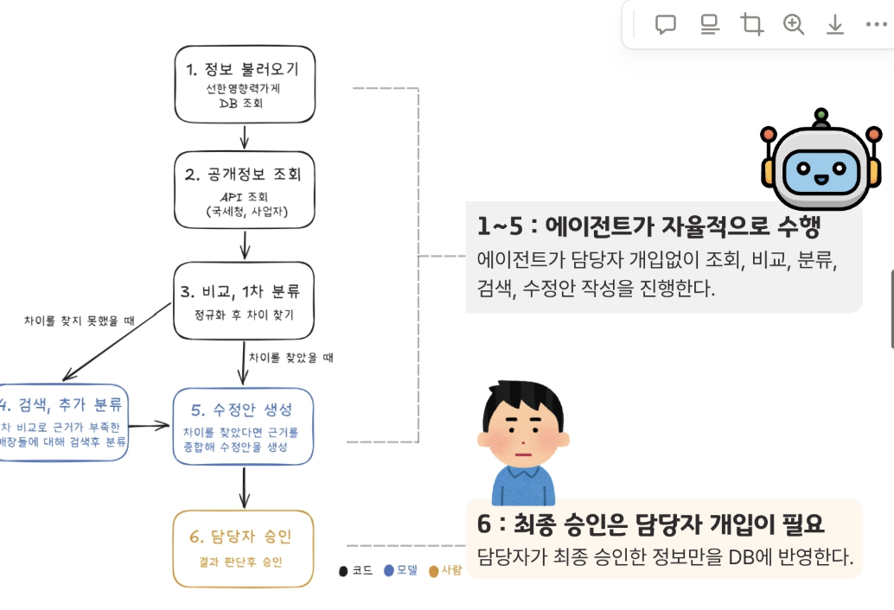

# 1회차 · 4주차

[목록](../../README.md#기술-멘토링) · [2회차 →](./02_7주차.md)

## 그때 상황

담당자 대신 에이전트가 공개 정보를 조회하고 비교해서, 바뀐 가게의 수정안을 만드는 구조였습니다. 담당자는 마지막에 승인만 합니다.

조회, 비교, 분류는 대부분 규칙으로 처리되고 LLM이 판단하는 곳은 검색과 수정안 작성뿐이어서, 이걸 에이전트 서비스라고 할 수 있는지가 팀의 고민이었습니다.

## 나온 이야기

- 네이버 지도의 저장 목록 공유만으로도 비슷한 일은 된다. 이 서비스를 써야 하는 이유가 분명해야 한다.
- 가게가 영업 중인지는 결국 누가 그 가게에 대해 글을 썼는지, 즉 검색 결과에 기대게 된다.
- 프로젝트로 보여 줄 수 있는 방향은 두 가지다. 프로덕트를 흥행시키는 것, 또는 기술로 문제를 풀었다는 것을 보여 주는 것.
- 기술로 간다면 핵심은 정보를 어디서 어떻게 가져오고 어떤 문장을 근거로 삼는지다.
- 가게 상태는 프로젝트 기간 안에 잘 바뀌지 않으니, 정답이 있는 데이터셋(골든 데이터셋)과 날짜별 변경 이력으로 동작을 보여 줘야 한다. 이력은 ERD의 Job, Task로 담을 수 있다.
- 기능이 작으면 한 사람이 짜는 게 빠르지만, 지금은 기능을 나눠 합치는 경험을 해 보는 것도 좋다.

## 정한 방향

- B2B 서비스이고 기관 컨택은 따로 하고 있어서, 기술로 문제를 푸는 쪽을 골랐습니다.
- 조사 결과에는 근거와 시점을 남기기로 했습니다.
- 기능별로 나눠 맡고, 1주 스프린트와 주간 PR 리뷰로 진행하기로 했습니다.

## 바뀐 것

- 조사 한 번을 Job, 가게별 결과를 Task로 남기는 테이블을 만들었고([#18](https://github.com/kakaotechcampus-4/ktc4-kyungpook-6/pull/18)), 국세청 정기 확인 이력은 따로 저장했습니다([#28](https://github.com/kakaotechcampus-4/ktc4-kyungpook-6/pull/28)).
- 골든 데이터셋은 이후 정보가 다른 가게 36곳과 대조군 24곳, 총 60곳으로 만들어 조사 에이전트를 측정했습니다. [2차 조사 문서](../../ai/docs/2차_조사.md#측정)
- 파트별로 나눠 개발하고 주 1회 `develop → main` PR로 멘토 리뷰를 받는 흐름이 이때 자리 잡았습니다. [깃 협업 규칙](../깃_협업_규칙.md)
- 검색 결과에 기댄다는 한계는 이후에도 계속 남았고, [3회차](./03_11주차.md)에서 방향을 바꾸는 계기가 됐습니다.
