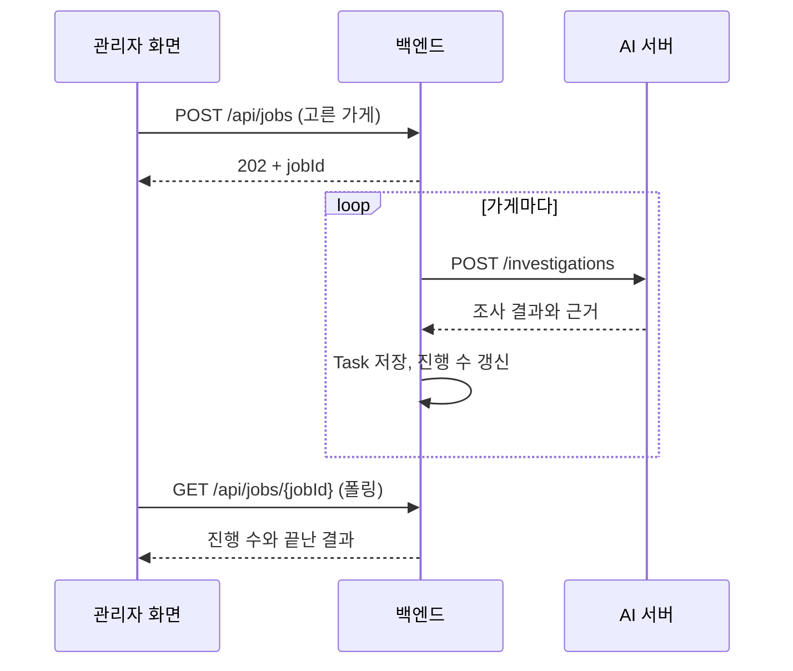

# 2회차 · 7주차

[← 1회차](./01_4주차.md) · [목록](../../README.md#기술-멘토링) · [3회차 →](./03_11주차.md)

## 그때 상황

- 백엔드와 AI 서버가 아직 연결되지 않았습니다. AI가 백엔드 조회 API를 불러 쓰는 구조로 반쯤 만들어져 있었는데, 담당자가 고른 가게만 조사하기에는 어색했습니다.
- 조사 시작 API를 기획 문서는 `POST /api/inspections`, 프론트는 `/api/jobs/{id}`로 가정했고, 백엔드에는 아직 없었습니다. 문서와 코드가 서로 다른 것을 기준으로 삼고 있었습니다.
- 반대로 가게 정보 수정 API는 백엔드가 스펙만 담아 501을 돌려주는 PR을 먼저 올리고([#31](https://github.com/kakaotechcampus-4/ktc4-kyungpook-6/pull/31)), 프론트가 그걸 보고 화면을 붙였을 때([#41](https://github.com/kakaotechcampus-4/ktc4-kyungpook-6/pull/41)) 어긋남이 없었습니다.
- 점주·아동 앱을 React Native와 Flutter 중 무엇으로 만들지 고르고 있었습니다.

## 나온 이야기

- 조사는 담당자가 가게를 고르면서 시작되니, 백엔드가 가게 ID를 받아 2차 조사가 필요한 가게만 하나씩 AI에 요청하는 게 자연스럽다. AI는 가게 하나를 조사하는 함수로 보면 된다.
- 기획 문서에는 왜, 무엇을 만드는지(문제, 화면 흐름, 판정 규칙)를 두고, 경로·필드명·enum처럼 자주 바뀌는 것은 코드와 Swagger를 기준으로 삼는다.
- 도메인 로직이 서버에 있으니 스펙 조율은 백엔드가 맡는다. 백엔드가 먼저 스펙을 공개하고 프론트는 그걸로 목업을 만든다. 분기가 많아 설명이 필요한 API만 문서를 따로 쓴다.
- 앱을 따로 만들면 웹 기능을 한 번 더 만들고, 서버 응답이 바뀔 때마다 두 곳을 고쳐야 한다. 웹뷰에 필요한 네이티브 기능만 붙이는 방식(Capacitor)도 있다.
- 네이버 블로그 같은 외부 데이터는 실험과 실제 서비스를 구분하고, 서비스에 넣기 전에 이용 조건을 확인한다.

## 정한 방향

- 조사는 백엔드가 AI를 호출하는 방향으로 연결합니다.
- API 스펙은 백엔드가 먼저 공개합니다.
- 점주·아동 앱은 관리자 화면과 같은 React로 만들고 Capacitor로 앱을 냅니다.

## 바뀐 것

- AI 서버에 `POST /investigations`를 두고 백엔드가 호출하도록 연결했습니다. [#36](https://github.com/kakaotechcampus-4/ktc4-kyungpook-6/pull/36), [#71](https://github.com/kakaotechcampus-4/ktc4-kyungpook-6/pull/71), [백엔드 연동 문서](../../ai/docs/백엔드_연동.md)
- 협업 규칙에 "파트 간 API 계약은 백엔드가 먼저 공개한다"를 넣었습니다. [#56](https://github.com/kakaotechcampus-4/ktc4-kyungpook-6/pull/56), [깃 협업 규칙](../깃_협업_규칙.md)
- `app/`을 React + Capacitor로 시작했고([#53](https://github.com/kakaotechcampus-4/ktc4-kyungpook-6/pull/53)), 점주 앱과 아동 앱을 같은 코드에서 APK 두 개로 냅니다([#166](https://github.com/kakaotechcampus-4/ktc4-kyungpook-6/pull/166)).
- 블로그를 읽는 조사 방식은 측정해 보니 가게당 25초가 늘고 효과가 거의 없어 넣지 않았습니다. [2차 조사 문서](../../ai/docs/2차_조사.md#넣지-않은-것)

## PR #58: Spring Batch 대신 Job

멘토링에서 "조사가 오래 걸리면 배치 작업도 방법"이라는 이야기가 나왔고, 8주차 PR [#58](https://github.com/kakaotechcampus-4/ktc4-kyungpook-6/pull/58)에서 2차 조사를 비동기로 돌리는 방법을 다시 다뤘습니다.

1. 멘토님이 Spring Batch 같은 배치 프로그램을 제안했습니다.
2. 동기 처리라 서버 작업자가 묶인다는 쟁점을 다시 짚다가, 멘토님이 이미 있는 Job 엔티티를 쓰는 편이 낫다고 정정했습니다. Job을 만들고 프론트가 상태를 폴링하는 구조였습니다.
3. 팀이 이해한 내용을 댓글로 정리해 확인했습니다. 202와 jobId를 바로 돌려주고, 조사는 뒤에서 한 건씩 AI를 호출하며 건마다 저장합니다. 일시 오류만 재시도하고, 나머지는 그 가게만 실패로 남깁니다.
4. 관리자 조사 시작·진행도 조회 API와 비동기 조사 실행기로 구현했습니다. [#73](https://github.com/kakaotechcampus-4/ktc4-kyungpook-6/pull/73)

마지막 멘토링에서 멘토님은 이 논의를 두고, 새 프레임워크를 들였다면 오버 스펙이었을 것을 대화로 막은 사례라고 하셨습니다.
