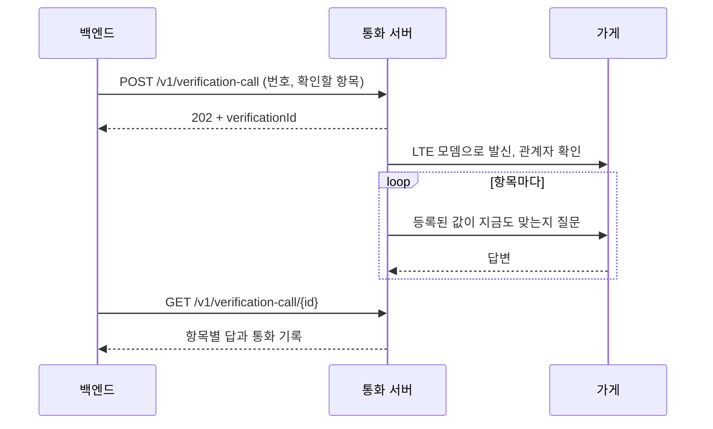

# 3회차 · 11주차

[← 2회차](./02_7주차.md) · [목록](../../README.md#기술-멘토링) · [4회차 →](./04_최종.md)

## 그때 상황

이때까지 에이전트가 일하는 곳은 조사 기능 하나였습니다. 조사를 다듬을수록 AI 파트는 이런 결론에 닿았습니다.

- 가게 정보가 바뀌면 사장님은 네이버와 카카오부터 고치기 때문에, 지도 대조만으로 대부분의 변경이 잡힌다.
- 네이버는 약관과 robots.txt 때문에 웹검색으로 가져올 수 없고, 나머지 웹검색 출처는 양이 적고 오래된 글이 많다.
- 그래서 LLM이 판단해 검색해도, 규칙대로 검색할 때와 결과 차이가 거의 없었다.

사전 질문에는 "조사는 동작하지만 이 부분에 AI의 판단이 꼭 필요한지 의문이다"라고 적었습니다. 함께 PM은, 틀린 수정은 되돌리기 어려워 일부러 남긴 담당자 승인을 줄여야 하는지 물었습니다.

## 나온 이야기

- 담당자 승인은 정확한 정보를 확인하는 데 필요한 부분이라 뺄 수 없다. 자율 구간을 억지로 넓히기보다 틀리는 경우를 줄이는 데 집중한다.
- 약관을 지키려고 타협한 과정이 병목이 됐다. 지금 기능이 에이전트를 잘 쓴다고 보기 어렵다면 다른 기능을 생각하는 게 맞다.
- 담당자가 가장 힘든 일은 인터넷에 정보가 없는 가게를 하나하나 전화로 확인하는 것이다. 지금 서비스는 그 부분을 "담당자가 직접 확인하세요"라는 한계로 남겨 두고 있었다.
- 정확한 정보를 아는 사람은 결국 점주다. 그 정보를 얻는 데 병목은 전화다. 요즘 에이전트가 사람 대신 전화해 예약을 잡듯, 영업 여부와 영업시간을 대신 전화로 확인하는 에이전트를 생각해 볼 수 있다.
- 관리자만 보지 말고 점주 쪽도 보자. 예를 들어 사업자등록증만 올리면 가입 정보가 채워지는 식으로 점주가 정보를 주기 쉽게 만들 수 있다.

## 정한 방향

- 조사 기능은 마무리하는 선에서 두고, 다음 주부터 에이전트 기능을 새로 넣기로 했습니다.
- 후보는 에이전트가 가게에 전화 걸기, 점주 가입 단순화 두 가지였습니다.
- 담당자 승인은 그대로 둡니다. 전화 결과도 수정안으로 올리고 담당자가 승인해야 반영됩니다.

같은 주에 만난 아동급식 분야 실무자도 가장 정확한 정보는 사장님이라고 했고, 이것이 방향을 바꾸는 데 힘을 실었습니다.

## 바뀐 것

### AI 확인 전화

통화 서버가 LTE 모뎀으로 가게에 실제 전화를 겁니다. 관계자인지 먼저 확인하고, 등록된 값이 지금도 맞는지 항목마다 묻습니다. 바뀌었다는 답에는 새 값을 다시 확인합니다. 백엔드는 통화 결과를 가져와 수정안과 통화 기록을 담당자에게 보여 줍니다. [통화 서버 문서](../../call/README.md)

- 통화 서버 전화 자동화 [#155](https://github.com/kakaotechcampus-4/ktc4-kyungpook-6/pull/155), 고도화 [#162](https://github.com/kakaotechcampus-4/ktc4-kyungpook-6/pull/162)
- 백엔드에서 전화를 걸고 결과 받기 [#153](https://github.com/kakaotechcampus-4/ktc4-kyungpook-6/pull/153), 응답 대기 초과는 다시 걸기 [#165](https://github.com/kakaotechcampus-4/ktc4-kyungpook-6/pull/165)
- 관리자 화면 전화 UI [#161](https://github.com/kakaotechcampus-4/ktc4-kyungpook-6/pull/161), 걸 수 없는 번호는 버튼 비활성 [#163](https://github.com/kakaotechcampus-4/ktc4-kyungpook-6/pull/163)
- 통화 서버 테스트를 CI에서 실행 [#156](https://github.com/kakaotechcampus-4/ktc4-kyungpook-6/pull/156)

### 사업자등록증 읽기

점주가 사업자등록증 사진을 올리면 AI가 사업자 정보를 읽어 가입 칸을 채웁니다. 읽지 못하면 직접 입력으로 넘어가고, 형식이 맞지 않는 값은 지어내지 않고 버립니다. 2회차에서 정한 대로 인터페이스를 먼저 공개하고 구현했습니다.

- 읽기 API 인터페이스 공개 [#122](https://github.com/kakaotechcampus-4/ktc4-kyungpook-6/pull/122), 횟수 제한 [#124](https://github.com/kakaotechcampus-4/ktc4-kyungpook-6/pull/124)
- 이미지에서 사업자 정보 추출 [#133](https://github.com/kakaotechcampus-4/ktc4-kyungpook-6/pull/133), 점주 앱 연결 [#144](https://github.com/kakaotechcampus-4/ktc4-kyungpook-6/pull/144)
