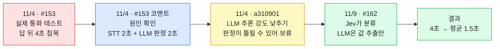
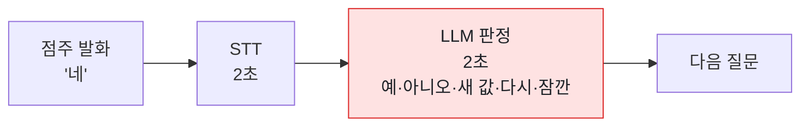
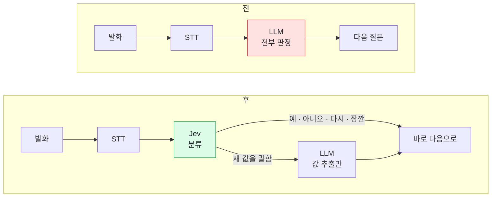

# 확인 전화에서 점주가 답한 뒤 4초씩 조용했던 문제

[← 트러블슈팅 목록](../../README.md#트러블슈팅)

| 파트 | 기간 | 관련 PR |
| --- | --- | --- |
| Call · Back | 2026-11-04 ~ 2026-11-09 | [#153](https://github.com/kakaotechcampus-4/ktc4-kyungpook-6/pull/153) · [#162](https://github.com/kakaotechcampus-4/ktc4-kyungpook-6/pull/162) |

> **한 줄 요약**
> 확인 전화를 실제로 받아 보니, 점주가 "네"라고 답한 뒤 다음 질문까지 4초씩 조용했습니다. 원인은 매 답마다 음성 인식(2초)과 LLM 판정(2초)을 거치는 구조였습니다. 답이 대부분 "네·아니요·다시요·잠깐만요"라는 점에 맞춰, 고르는 일은 분류 모델 Jev에 맡기고 LLM은 새 값을 뽑을 때만 부르게 나눠 **평균 1.5초**로 줄였습니다. 빨라진 만큼 잘못 알아듣고 저장하는 일은 상태 머신과 확신도 기준으로 막았습니다.

## 한눈에 보기



## 문제

#153에서 관리자 서비스에 확인 전화를 붙이고, 팀원 번호로 실제 통화를 걸어 봤습니다. 질문하고 답을 받는 것까지는 문제없었습니다. 끝까지 간 통화는 답 3개가 다 들어왔고, 상호명을 바꿔 말한 것도 그대로 저장됐습니다.

그런데 직접 받아 보니 대화가 계속 뚝뚝 끊겼습니다. "네"라고 답하고 나면 다음 질문이 나올 때까지 4초 정도 아무 소리가 없었습니다. 받는 입장에서는 끊긴 줄 알고 먼저 끊기 딱 좋은 시간이었습니다.

그때 남긴 기록입니다.

```
09:02:07 요청 → 09:02:11 발신 → 09:02:39 연결 → 09:04:16 종료
```

| 통화 | 연결부터 종료까지 | 주고받은 횟수 |
| --- | --- | --- |
| 세 항목 재확인, 끝까지 | 79초 | 4번 |
| 한 항목 답하고 끊음 | 33초 | 2번 |

세 가지를 물어보는 데 80초 가까이 걸렸고, 중간에 한 번 끊겼다가 이어진 통화는 3분 20초까지 갔습니다.

이 기능은 전화를 거는 것보다 끝까지 답을 듣는 게 중요합니다. 가게에서 중간에 끊어 버리면 실패로 남고 담당자가 다시 걸어야 하니까, 이 침묵이 그대로 실패율이 될 것 같았습니다.

## 원인

처음에는 백엔드 쪽을 의심했는데, 백엔드가 전화 API를 부르는 건 0.2초면 끝났습니다. 말하고 듣는 건 전부 전화 API 서버 안에서 일어나는 일이었습니다.

전화 파트가 #153 코멘트로 원인을 짚었습니다. 점주 말이 끝나면 음성을 글자로 바꾸는 데(STT) 2초, 그걸 LLM이 판정하는 데 2초가 걸리고 있었습니다.



LLM이 매번 "예인지 아니오인지, 새 값을 말한 건지, 다시 말해 달라는 건지"를 판단하고 있었는데, 확인 전화에서 나오는 답은 거의 "네", "아니요", "다시요", "잠깐만요" 정도입니다. 이 정도를 고르는 데도 매번 LLM을 거치고 있던 게 문제였습니다.

LLM 추론 강도를 낮춰 보는 것도 생각했지만(`a310901`), 판정이 틀려질 수 있어서 충분히 테스트하기 전에는 바로 적용하기 어렵다고 봤습니다.

## 해결

### 고르는 일과 값을 뽑는 일을 나눴다 · [#162](https://github.com/kakaotechcampus-4/ktc4-kyungpook-6/pull/162)



- 답 종류와 통화 흐름(멈춤, 대기, 계속, 다시 말하기)은 선택지 고르기에 특화된 Jev가 분류합니다(`04d98c2`).
- LLM은 새 상호명이나 주소처럼 값이 필요할 때만 부르고, 판정은 맡기지 않습니다(`7385294`).
- LLM이 값을 처리하는 동안에는 대기 음성을 틀어서 조용한 시간이 생기지 않게 했습니다(`c7f480b`).
- 자주 쓰는 문구는 음성을 미리 만들어 재사용합니다(`dde6460`, `fec41e7`).

### 빨라진 만큼 잘못 저장하지 않게 막았다

판정을 가벼운 모델로 옮기면 잘못 알아듣고 저장하는 일이 생길 수 있어서, 그 부분도 같이 막았습니다. Jev는 분류만 하고 저장 여부는 상태 머신이 정합니다. 확신도가 낮으면 넘겨짚지 않고 다시 묻고, 새 값은 "네" 한마디로 끝내지 않고 값을 다시 말해야 저장합니다([통화 서버 대화 규칙](../../call/README.md#대화-규칙)).

### 백엔드는 늦어지거나 끊겨도 잃지 않게 받는다 · [#153](https://github.com/kakaotechcampus-4/ktc4-kyungpook-6/pull/153)

백엔드에서는 전화 API 속도를 바꿀 수 없으니, 통화가 늦어지거나 끊겨도 들은 걸 잃지 않는 쪽으로 받는 부분을 짰습니다.

- 영업 여부를 제일 먼저 묻습니다. 하나만 듣고 끊긴다면 그게 영업 여부여야 하기 때문입니다.
- 끊긴 통화도 그때까지 들은 답은 저장해서 화면에 보여 줍니다. 처음엔 화면에서 이걸 버리고 있었는데 실제 통화를 해 보다가 찾았습니다.
- 재확인 전화에서는 전화번호를 묻지 않습니다. 그 번호로 연결된 것 자체가 답이라 질문을 하나 줄였습니다.
- 통화 결과는 폴러가 10초마다 가져옵니다. 통화가 길어져도 관리자 화면은 DB만 읽습니다.

## 결과

**Before / After**

| | Before | After |
| --- | --- | --- |
| 점주가 답한 뒤 다음 말까지 | 4초 | **평균 1.5초** |
| 답을 판정하는 것 | LLM이 매번 | Jev가 분류, LLM은 새 값이 있을 때만 |
| LLM이 값을 처리하는 동안 | 아무 소리 없음 | 대기 음성 |
| 자주 쓰는 문구 | 매번 음성 합성 | 미리 만든 음성 재사용 |
| 잘못 알아들었을 때 | LLM 판단을 그대로 따름 | 확신도가 낮으면 다시 묻고, 새 값은 다시 말해야 저장 |

- 점주가 답한 뒤 다음 말이 나오기까지 4초에서 평균 1.5초로 줄었습니다([#162](https://github.com/kakaotechcampus-4/ktc4-kyungpook-6/pull/162)).
- 예/아니오만 오가는 재확인 전화는 이제 LLM을 거의 부르지 않습니다.
- 바뀐 뒤의 실제 통화는 [README의 실제 통화 들어 보기](../../README.md#실제-통화-들어-보기)에서 들을 수 있습니다.

## 배운 점

1. **사람을 상대하는 기능은 직접 써 봐야 보인다.** 테스트는 다 통과했는데 4초 침묵은 직접 전화를 받아 보고서야 알았습니다. 모의 서버 테스트로는 답이 제대로 들어오는지만 보이고, 받는 사람이 답답한지는 안 보입니다. 실제로 써 보는 시간을 일정에 따로 잡아야 합니다.
2. **모든 입력을 제일 무거운 모델에 보낼 필요는 없다.** 답이 대부분 정해진 몇 가지라면 가벼운 분류기로 고르고, LLM은 진짜 필요할 때만 쓰는 게 맞았습니다.
3. **빠르게 바꿀 때는 틀렸을 때를 같이 정한다.** 가벼운 모델로 옮기면서 저장 여부는 상태 머신이 정하고, 확신이 낮으면 다시 묻게 했기 때문에 속도와 정확도를 같이 지킬 수 있었습니다.

<sub>원인 진단과 Jev 도입(#162)은 전화 파트가, 끊겨도 잃지 않게 받는 부분(#153)은 Back 파트가 했습니다.</sub>
