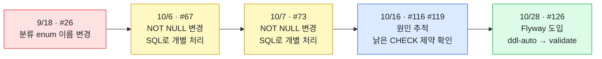
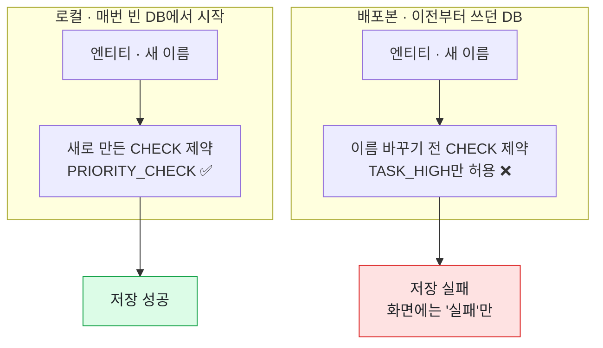

# 로컬에선 되는데 배포본에서만 조사 저장이 실패한 이유: `ddl-auto`와 CHECK 제약

[← 트러블슈팅 목록](../../README.md#트러블슈팅)

| 파트 | 기간 | 관련 PR |
| --- | --- | --- |
| Back · Infra | 2026-09-18 ~ 2026-10-28 | [#26](https://github.com/kakaotechcampus-4/ktc4-kyungpook-6/pull/26) · [#67](https://github.com/kakaotechcampus-4/ktc4-kyungpook-6/pull/67) · [#73](https://github.com/kakaotechcampus-4/ktc4-kyungpook-6/pull/73) · [#116](https://github.com/kakaotechcampus-4/ktc4-kyungpook-6/pull/116) · [#119](https://github.com/kakaotechcampus-4/ktc4-kyungpook-6/pull/119) · [#126](https://github.com/kakaotechcampus-4/ktc4-kyungpook-6/pull/126) |

> **한 줄 요약**
> 코드에서 enum 이름을 바꿨는데 배포본 DB의 CHECK 제약은 옛 이름 그대로 남았습니다. `ddl-auto: update`는 이미 있는 제약을 고치지 않기 때문입니다. 로컬은 DB를 매번 새로 만들어 문제가 드러나지 않았고, 개발용 배포본에서만 조사 결과 저장이 실패했습니다. 원인을 DB 제약까지 추적해 확인한 뒤, Flyway를 들여 스키마를 마이그레이션으로 관리하고 코드와 DB가 어긋나면 서버가 뜨지 않게 바꿨습니다.

## 한눈에 보기



## 문제

9월 18일, 조사 결과 분류 값의 이름을 프론트 화면과 맞추려고 바꿨습니다([#26](https://github.com/kakaotechcampus-4/ktc4-kyungpook-6/pull/26), 커밋 `e0f6a4e`).

```diff
- TASK_HIGH        TASK_LOW            TASK_NONE
+ PRIORITY_CHECK   ADDITIONAL_CHECK    NO_CHANGE
```

코드와 테스트는 모두 새 이름으로 고쳤고, 로컬과 테스트에서는 문제없이 돌았습니다. 그런데 **개발용 배포본(dev)에서는 조사 결과를 저장하는 단계가 실패**했습니다.

```
ERROR: new row for relation "task" violates check constraint "task_classification_check"
1차 결과 저장 실패 - jobId=2, storeId=1
```

이 로그는 서버 안에만 남았고 화면에는 "실패"만 표시됐습니다. 실제 사용자가 쓰기 전인 개발용 배포본이라 바로 드러나지 않았고, 10월 중순 배포 환경을 점검하면서 본격적으로 추적했습니다. 처음에는 AI 자격증명을 의심했지만, 자격증명을 고친 뒤에도 조사는 **49ms 만에** 끝나 버렸습니다. AI를 부르기도 전에, 국세청 대조로 만든 1차 결과를 저장하는 자리에서 막힌다는 신호였습니다.

## 원인

### `ddl-auto: update`는 더하기만 한다

스키마를 JPA의 `ddl-auto: update`로 맞추고 있었습니다. 이 설정은 엔티티에 새로 생긴 표와 컬럼은 만들어 주지만, **이미 있는 제약은 고치지 않습니다.**

| `ddl-auto: update`가 | |
| --- | --- |
| 새 표, 새 컬럼 | ✅ 만든다 |
| 바뀐 enum 값에 맞춰 CHECK 제약 고치기 | ❌ 그대로 둔다 |
| NOT NULL 풀기 | ❌ 그대로 둔다 |

그래서 로컬과 배포본이 서로 다른 DB를 보고 있었습니다.



```
DB    task_classification_check = ARRAY['TASK_HIGH','TASK_LOW','TASK_NONE']
코드   PRIORITY_CHECK · ADDITIONAL_CHECK · NO_CHANGE
```

### 같은 원인이 이미 다른 모습으로 보였다

돌아보면 그 사이 백엔드에서 같은 원인의 문제가 두 번 있었습니다.

| PR | 바꾼 것 | 그때 처리 |
| --- | --- | --- |
| [#67](https://github.com/kakaotechcampus-4/ktc4-kyungpook-6/pull/67) (10/6) | Signal의 `confidence`를 선택값으로 | `ddl-auto`가 NOT NULL을 풀지 않는 걸 확인하고, 배포 서버에서 실행할 SQL을 PR에 적음 |
| [#73](https://github.com/kakaotechcampus-4/ktc4-kyungpook-6/pull/73) (10/7) | 조사 실패 시 `classification`을 비움 | 운영과 같은 스키마로 로컬에서 재현해 필요성을 확인하고, SQL을 PR에 적음 |

그때는 PR마다 필요한 SQL을 따로 적어 처리했습니다. #119에서 원인을 정리하면서 **"`ddl-auto`는 CHECK 제약도 NOT NULL도 따라오지 않는다"**는 하나의 구조 문제로 드러났고, 그래서 SQL을 한 번 더 적는 대신 스키마를 관리하는 방식 자체를 바꾸기로 했습니다.

## 해결

### 1. 원인 확인과 응급 처치 · [#116](https://github.com/kakaotechcampus-4/ktc4-kyungpook-6/pull/116), [#119](https://github.com/kakaotechcampus-4/ktc4-kyungpook-6/pull/119)

배포본 DB의 제약 목록을 읽어 오는 진단 워크플로를 만들어 원인을 확인했습니다. 기본은 읽기만 하고, 지우려면 표 이름과 제약 이름을 둘 다 입력해야 합니다. 배포본 스키마를 다시 만들어 조사를 살렸습니다. 이때 PR에 이렇게 적었습니다.

> 근본 해결은 마이그레이션 도구(Flyway 등)입니다. enum을 바꿀 때마다 같은 일이 납니다.

### 2. 근본 해결: Flyway 도입 · [#126](https://github.com/kakaotechcampus-4/ktc4-kyungpook-6/pull/126)

스키마를 `ddl-auto`가 아니라 **버전이 붙은 마이그레이션 파일**이 바꾸게 했습니다.

| 파일 · 설정 | 하는 일 |
| --- | --- |
| `ddl-auto: update` → **`validate`** | 엔티티와 DB가 어긋나면 서버가 뜨지 않음 |
| `V1__baseline_schema.sql` | 지금 엔티티 기준 전체 스키마(표 16개). 이미 돌고 있는 DB는 "V1까지 끝남"으로 표시만 함 |
| `V2__sync_constraints_with_code.sql` | 돌고 있는 DB의 CHECK 제약을 코드에 맞춤 |

**`none`이 아니라 `validate`를 고른 이유**: `none`은 어긋나도 그냥 뜹니다. 이번에 고치려던 게 바로 "조용히 어긋나는 것"이라, 차라리 기동이 멈추는 쪽을 골랐습니다.

**CHECK 제약은 `NOT VALID`로 걸었습니다**: 그냥 걸면 Postgres가 기존 행까지 검사해서, 옛 값이 한 줄만 남아 있어도 마이그레이션이 실패하고 백엔드가 뜨지 않습니다. 막으려던 건 "앞으로 저장될 값이 거절당하는 일"이라 새 행만 검사하면 충분했습니다.

## 결과

**Before / After**

| | Before | After |
| --- | --- | --- |
| 스키마를 바꾸는 것 | `ddl-auto: update`가 알아서 | 마이그레이션 파일(V1, V2, …) |
| 엔티티와 DB가 어긋나면 | 서버는 뜨고, 저장할 때 조용히 실패 | **서버가 뜨지 않음** |
| 로컬과 배포본 | 서로 다른 DB를 봄 | 같은 마이그레이션을 차례로 밟음 |
| 제약을 바꿀 때 | 서버에서 SQL을 손으로 실행 | PR에 마이그레이션 파일을 같이 냄 |

- 배포본 조사가 다시 끝까지 돕니다. 가게 5곳 모두, 16초([#119](https://github.com/kakaotechcampus-4/ktc4-kyungpook-6/pull/119)).
- #126에서 실제로 띄워 확인했습니다. 빈 DB는 3.6초에 기동하고, 사고 상태를 재현한 DB는 V2가 제약을 고쳤고, CI도 통과했습니다.
- 그 뒤 백엔드 PR은 마이그레이션을 같이 냅니다. [#145](https://github.com/kakaotechcampus-4/ktc4-kyungpook-6/pull/145)는 V6, [#150](https://github.com/kakaotechcampus-4/ktc4-kyungpook-6/pull/150)은 V8을 함께 넣었고, 순서가 바뀌면 Flyway가 기동을 멈추기 때문에 PR 본문에 머지 순서를 적었습니다.

## 배운 점

1. **로컬에서 된다고 배포본에서 되는 건 아니다.** 로컬은 DB를 새로 만들어서 스키마가 어긋난 걸 볼 수 없습니다. 스키마를 바꾸는 PR은 "이미 데이터가 있는 DB에서는 어떻게 되나"를 따로 물어야 합니다.
2. **손으로 하는 일이 반복되면 구조로 옮긴다.** 배포 서버에서 SQL을 직접 실행하는 일이 두 번 생긴 시점이, 마이그레이션 도구가 필요하다는 신호였습니다. 지금은 스키마 변경이 PR 안의 파일로 남아 리뷰와 CI를 같이 거칩니다.
3. **조용히 실패하는 것보다 바로 멈추는 게 낫다.** 저장 단계에서 실패하면 원인이 로그 속에 묻힙니다. `validate`처럼 어긋나는 순간 기동이 멈추면 배포한 그 자리에서 알 수 있습니다.

<sub>원인 진단(#116, #119)과 Flyway 도입(#126)은 Infra 파트가 했습니다.</sub>
