# 모델이 "0.9 넘는 확신"으로 틀렸다: AI 응답 품질을 테스트셋으로 재고, 실패를 분석해 고친 기록

[← 트러블슈팅 목록](../../README.md#트러블슈팅)

| 파트 | 기간 | 관련 PR |
| --- | --- | --- |
| AI | 2026-09-08 ~ 2026-10-28 | [#11](https://github.com/kakaotechcampus-4/ktc4-kyungpook-6/pull/11) · [#16](https://github.com/kakaotechcampus-4/ktc4-kyungpook-6/pull/16) · [#24](https://github.com/kakaotechcampus-4/ktc4-kyungpook-6/pull/24) · [#30](https://github.com/kakaotechcampus-4/ktc4-kyungpook-6/pull/30) · [#42](https://github.com/kakaotechcampus-4/ktc4-kyungpook-6/pull/42) · [#54](https://github.com/kakaotechcampus-4/ktc4-kyungpook-6/pull/54) · [#74](https://github.com/kakaotechcampus-4/ktc4-kyungpook-6/pull/74) · [#89](https://github.com/kakaotechcampus-4/ktc4-kyungpook-6/pull/89) · [#108](https://github.com/kakaotechcampus-4/ktc4-kyungpook-6/pull/108) · [#120](https://github.com/kakaotechcampus-4/ktc4-kyungpook-6/pull/120) · [#134](https://github.com/kakaotechcampus-4/ktc4-kyungpook-6/pull/134) — 멘토 리뷰는 [#12](https://github.com/kakaotechcampus-4/ktc4-kyungpook-6/pull/12) · [#25](https://github.com/kakaotechcampus-4/ktc4-kyungpook-6/pull/25) |

> **한 줄 요약**
> AI 파트는 처음부터 "돌려 보니 되더라"가 아니라 **정답지가 있는 테스트셋과 수치**로 품질을 쟀습니다. 첫 벤치마크에서 모델은 23건 중 0건을 맞히면서 9건에 확신도 0.90~1.00을 달았고, 그 측정이 설계를 바꿨습니다(정답 하나 → 후보 여러 개 + 외부 검증). 이후 2차 조사도 공공데이터로 만든 60곳 벤치마크로 웹검색만·지도 대조·에이전트를 비교해 **10곳 → 22곳**으로 올렸고, 측정하고 넣지 않은 것까지 이유를 남겼습니다. 측정 도구 자체의 버그(분모·캐시·예외 삼킴)도 세 번 잡혔습니다.

## 한눈에 보기

```mermaid
flowchart LR
    subgraph P1["① 사업자등록번호 웹검색 폴백"]
        A["9/9 · #11<br/>fixture 23건 벤치마크<br/>완전일치 0/23<br/>오답 9건이 confidence 0.9+"]:::cause
        B["9/10 · 멘토 리뷰 #12<br/>분모 버그 · 파싱 예외<br/>confidence 게이트 금지"]:::found
        C["9/16 · #24<br/>후보 여러 개 + 비즈노 검증<br/>0% → 23.8%"]:::fix
        D["9/19 · #30<br/>파싱 실패율 재다가<br/>실패 가리던 경로 3곳"]:::found
        A --> B --> C --> D
    end
    subgraph P2["② 2차 조사"]
        E["9/30 · #54<br/>인허가 60곳에<br/>오류 34곳 심은 벤치마크"]:::cause
        F["10/7 · #74<br/>웹검색만 10 → 지도 먼저 22<br/>흔들림 13~18% → 2%"]:::fix
        G["10/14 · #108<br/>시간 예산 75초<br/>벤치마크 ↓ 서비스 ↑"]:::fix
        H["10/16 · #120<br/>거짓 다름 11 → 10<br/>근거 문구를 코드 틀로"]:::fix
        I["10/28 · #134<br/>모델 3종 비교<br/>고친 수 같음"]:::found
        E --> F --> G --> H --> I
    end
    D --> E
    classDef cause fill:#FEE2E2,stroke:#DC2626,color:#1F2328
    classDef found fill:#DBEAFE,stroke:#2563EB,color:#1F2328
    classDef fix fill:#DCFCE7,stroke:#16A34A,color:#1F2328
```



## 문제

### ① 간판 이름으로는 사업자등록번호가 안 나온다

국세청 조회는 사업자등록번호로 합니다. 번호가 비어 있으면 상호명으로 비즈노에 묻는데, 등록명은 간판과 다릅니다(`성심당` → `주식회사 로쏘`). 그래서 LLM 웹검색으로 등록명을 찾는 폴백을 만들었고([#11](https://github.com/kakaotechcampus-4/ktc4-kyungpook-6/pull/11)), **처음부터 정답지가 있는 fixture 23건과 벤치마크 스크립트**(`ai/eval/benchmark.py`)를 같이 냈습니다.

첫 측정 결과입니다.

```
완전일치           0 / 23
그럴듯한 오답       9건 — confidence 0.90 ~ 1.00
                   (입력을 그대로 되돌려주거나, 실재하는 다른 법인을 찾아옴)
```

모델이 틀리는 것보다 **틀리면서 확신하는 것**이 문제였습니다. 이 confidence 로 자동 반영 구간을 둘 생각이었는데, 수치가 그 길을 막았습니다.

### ② 2차 조사는 정답이 없다

1차 조사(국세청)에서 변화가 안 잡힌 가게를 웹검색으로 다시 보는 2차 조사([#54](https://github.com/kakaotechcampus-4/ktc4-kyungpook-6/pull/54))는 더 어려웠습니다. 실데이터가 없고, 있어도 **"이 가게가 진짜 바뀌었는지"를 아는 사람이 없어서** 맞았는지 셀 수가 없습니다. 돌려 보면 결과가 나오긴 하는데, 그게 좋은 건지 나쁜 건지 말할 근거가 없었습니다.

## 원인

### 측정 도구가 먼저 틀려 있었다

5주차 멘토 리뷰([#12](https://github.com/kakaotechcampus-4/ktc4-kyungpook-6/pull/12))가 벤치마크 코드에서 두 가지를 잡았습니다.

| 지적 | 왜 문제인가 |
| --- | --- |
| `avg_confidence` 분모가 전체 건수 | API 에러로 건너뛴 건이 분자에는 없고 분모에는 있다. 10건 중 5건이 레이트리밋이면 확신도가 **실제의 절반**으로 찍히는데, 표에 실패 수가 없어 "이 모델은 확신도가 낮구나"로 오독한다 |
| `openai.APIError` 만 잡음 | `JSONDecodeError`·`content=None` 의 `TypeError` 가 안 잡혀 **한 케이스 때문에 벤치마크 전체가 중단**된다 |

그리고 설계에 대한 답이 함께 왔습니다. *"confidence 임계값으로 자동 반영 구간을 두는 것은 지금은 하지 마세요." "모델이 뱉는 확신도는 자기 보고입니다. 실제 정답률과 잘 맞지 않는 걸로 알려져 있고, 특히 '0.9인데 틀린' 케이스가 '0.4인데 맞는' 케이스보다 위험합니다."* 대신 **찾아온 이름을 비즈노·국세청으로 다시 검증하고, 추측값은 확정값과 다른 자리에 두라**는 것이었습니다.

### 모델은 본사를 찾고, 등록은 지점 사업자다

설계를 바꾼 뒤에도(아래 해결 1) 막히는 건이 남았는데, 틀린 건을 하나씩 열어 보니 모델 탓이 아니었습니다.

| 상호명 | 모델이 찾은 것 | 국세청 등록명 |
| --- | --- | --- |
| 세븐일레븐 우정조암점 | `(주)코리아세븐` | `미니스톱 우정조암점` |
| CU 의정부호원가든점 | `BGF리테일` | `씨유 의정부호원가든점` |

실제 운영사를 찾아온 것이고, 개별 지점의 사업자 정보는 웹에 없습니다. 프롬프트를 고쳐서 될 일이 아니라 **소스가 없는 문제**라고 적어 두고 멈췄습니다([`ai/docs/웹검색_폴백.md`](../../ai/docs/웹검색_폴백.md) "막힌 이유").

### 2차 조사는 웹검색이 약하고 지도가 셌다

정답이 없는 문제는 **정답을 만들어서** 쟀습니다([#54](https://github.com/kakaotechcampus-4/ktc4-kyungpook-6/pull/54), [#74](https://github.com/kakaotechcampus-4/ktc4-kyungpook-6/pull/74)). 공공데이터 인허가 목록에서 **영업 중인 가게 60곳**을 뽑아 "담당자가 확인을 마친 DB"처럼 만들고, 가게마다 한 항목만 일부러 조금 틀리게 넣었습니다(`ai/eval/mismatch_bench.py`).

```
phone     마지막 네 자리 중 한 자리         053-567-3050 → 053-567-3080
address   도로명 건물번호 +2               국채보상로67길 38 → 국채보상로67길 40
name      핵심 이름의 한 글자 모음(오타)    빠레뜨치킨 → 빠래뜨치킨
control   손대지 않는다 (대조군 — 오탐을 센다)
```

이 틀로 세 방식을 비교한 결과입니다([#74](https://github.com/kakaotechcampus-4/ktc4-kyungpook-6/pull/74), 오류 34곳).

| 방식 | 잡은 수 | 값까지 담은 수정안 | 가게당 LLM 호출 | 판정 흔들림 |
| --- | --- | --- | --- | --- |
| 웹검색만 (기존) | 10 | 9 | 1+ | 13~18% |
| 지도 대조 먼저, 안 되면 웹 | 22 | 11 | 0.5 | 2% |
| 지도 + 에이전트가 다음 검색을 판단 | 21.5 | 13 | 2.7 | 3% |

**기존 설계(웹검색만)가 가장 못 잡고 가장 흔들렸습니다.** 지도(카카오·네이버 지역 검색)를 먼저 대조하는 쪽이 두 배를 잡았고, 에이전트는 잡는 수는 같은데 LLM 호출이 다섯 배였습니다. 이 표가 2차 조사의 순서를 "지도 → 웹"으로 뒤집었습니다.

## 해결

### 1. 정답이 아니라 후보를 받고, 비즈노가 검증한다 · #16, #24

`{official_name, confidence}` 하나를 요구하던 프롬프트를 버리고 **후보 여러 개 + 근거·주소·사업자번호**를 받게 했습니다. 주소가 다른 지역이면 기각, 번호가 있으면 역조회, 아니면 이름으로 비즈노 검색. `confidence` 필드는 없앴습니다 — 모델은 정확할 필요 없이 **후보 안에 정답이 하나만 있으면** 됩니다.

같은 21건으로 다시 쟀습니다.

| 방식 | 번호 도달률 |
| --- | --- |
| 원본 상호명을 비즈노에 직접 | 0 / 21 |
| 정답 이름 하나를 맞혀라 (폐기) | 0 / 23 |
| **후보 생성 + 비즈노 검증** | **5 / 21 = 23.8%** |
| 오라클 — 정답 이름을 안다고 가정 | 18 / 21 = 85.7% |

오라클 행이 중요했습니다. **이름만 알아내면 번호는 나온다**는 전제가 성립한다는 뜻이라, 폴백을 포기하지 않을 근거가 됐습니다. 동시에 23.8%는 "정답이 후보 안에 있었다"(recall)이지 "골라냈다"(precision)가 아니라고 문서에 못 박았습니다. 그래서 **폴백 결과는 DB 에 자동으로 쓰지 않고 담당자 큐에 올립니다.**

### 2. 파싱 실패율을 재려다 실패를 가리던 경로 셋을 찾았다 · #30

그라운딩 검색은 structured output 을 강제할 수 없습니다(`controlled generation is not supported with Search tool`). 6주차 멘토 리뷰([#25](https://github.com/kakaotechcampus-4/ktc4-kyungpook-6/pull/25))는 *"지금 근거가 '아직 깨진 적은 없다'인데, 이건 관측이 없어서 모르는 것일 수도 있습니다."*라며, ① 파싱 실패율을 먼저 재고, ② 1회 재시도를 넣고, ③ 실패가 유의미하면 2단계로 나누라고 권했습니다.

①을 넣다가 리포트가 거짓말을 하고 있던 자리가 세 군데 나왔습니다.

| 가려지던 경로 | 고친 것 |
| --- | --- |
| 파싱 실패를 `[]` 로 **캐시** — 일시 실패가 영구 캐시돼 재시도도 안 되고 리포트에도 안 잡힘 | 파싱 실패는 캐시하지 않는다 |
| 건 단위로만 집계 — 1차가 깨지고 2차가 성공하면 "실패 0건" | 시도 단위로 세고, 재시도로 복구된 건과 전부 실패한 건을 나눠 출력 |
| 캐시 히트가 분모에 포함 — 모델을 부르지 않은 건이 실패율을 희석 | 분모는 실제 호출 건수(`called`) |

재 보니 **23건 중 파싱 실패 0건**(95% 상한 약 14%)이었고, 이 수치가 호출이 두 배 되는 ③ 2단계 분리를 **하지 않는 근거**가 됐습니다. 카카오 로컬 API 교차검증도 실험했지만 결과에 유의미한 차이가 없어 넣지 않았습니다([#42](https://github.com/kakaotechcampus-4/ktc4-kyungpook-6/pull/42)).

### 3. 2차 조사는 벤치마크로 한 단계씩 바꿨다 · #74, #89, #108, #120, #134

**지도 먼저**([#74](https://github.com/kakaotechcampus-4/ktc4-kyungpook-6/pull/74)) — 위 표대로 순서를 뒤집었습니다. 약관 때문에 지도 값은 판정에만 쓰고 저장·LLM 전송은 하지 않는데, 팀 리뷰가 코드 다섯 겹과 평가 CSV 쓰기 직전까지 값이 안 새는 것을 따라가 확인했습니다. 같은 리뷰에서 **에이전트 경로의 웹검색 실패가 "변화없음"으로 조용히 끝나는 것**(담당자가 틀린 화면을 보는 종류)과, 지역어 제거가 `대구왕갈비본점` → `왕갈비본점` 으로 잘라 **다른 가게를 같은 가게로 매칭하는 경로**가 잡혔고 [#89](https://github.com/kakaotechcampus-4/ktc4-kyungpook-6/pull/89) 에서 고쳤습니다. #89 리뷰 중에는 지번 주소 정규식이 정상 주소 세 가지(`범어동 48-1` 등)를 놓치게 된 회귀를 찾아 되돌렸습니다.

**시간 예산 75초**([#108](https://github.com/kakaotechcampus-4/ktc4-kyungpook-6/pull/108)) — 벤치마크 숫자와 서비스가 받는 결과가 **반대로** 움직인 자리입니다.

```
예산 없이 끝까지 기다리면      잡음 22 · 값 11  →  20 · 8    (벤치마크는 조금 나빠진다)
백엔드가 75초에 끊는 실제 조건  잡음 13 · 값 5   →  18 · 7    (서비스가 받는 결과는 늘어난다)
75초를 넘기는 가게             14곳  →  3곳
```

남은 시간이 40초 미만이면 새 웹검색 없이 모은 근거로 판정합니다. 멘토 제안이던 네이버 블로그 에이전트는 **재 보고 뺐습니다** — 잡음 18 → 17, 값 9 → 9, 가게당 +25초, 폐업 신호는 실행마다 흔들림.

**거짓 "다름" 줄이기**([#120](https://github.com/kakaotechcampus-4/ktc4-kyungpook-6/pull/120)) — 오류를 심기 전의 60곳(DB 가 맞는 가게)으로 지도가 내는 거짓 신호를 따로 쟀습니다.

| | 다름 | 지도에서 전부 못 찾음 |
| --- | --- | --- |
| 동네 조건 넣기 전 | 11곳 | 17곳 |
| 동네 조건 넣은 뒤 | 8곳 | 18곳 |
| + 이름 규칙(지점명·바로 옆·&) | 11곳 | 14곳 |
| **+ 안심번호 제외** | **10곳** | 23곳 |

오류를 잡는 수는 세 단계 모두 같았습니다. 이사 흉내(주소·좌표를 다른 구의 가게 것으로 바꿈)는 카카오에 번호가 같은 10곳 중 7곳을 잡았고 **오탐 0**이었습니다. 근거 문구는 모델이 자유롭게 쓰게 두면 영어로 나오거나 두서없이 길어져서, **코드가 정한 틀**로 바꿨습니다(`classify._change_text`). 변화없음에도 "DB 값과 일치 — 카카오맵"처럼 근거를 붙여 **"확인됨"과 "못 찾음"을 담당자가 구분**하게 했습니다. 이 PR 리뷰에서는 에이전트 인스턴스를 공유해 요청이 겹치면 **다른 가게의 근거가 붙는** 경쟁 조건을 두 스레드로 재현해 적어 뒀습니다.

**모델 비교**([#134](https://github.com/kakaotechcampus-4/ktc4-kyungpook-6/pull/134)) — 웹검색 제공자에 Claude 를 추가하고 같은 60곳을 돌렸습니다.

| | Vertex (Gemini Flash) | Claude Opus 5.5 | Claude Haiku 5.5 |
| --- | --- | --- | --- |
| 확인된 값으로 고침 | 17 | 17 | 16 |
| 대조군 24곳 중 제안 없음 | 18 | 16 | 20 |
| 거짓 신호의 성격 | 영업 상태(폐업·휴업) | 지점명만 뗀 가게명 9 → 규칙으로 5 | — |
| 평균 시간 | 17초 | 12초 | 15초 |

고친 수는 같고 **거짓 신호의 성격이 달랐습니다.** Sonnet 은 인용을 붙이지 않아 모든 관측이 출처 없음으로 떨어져 쓸 수 없었습니다. "다음에 무엇을 검색할지"를 규칙이 정하나 모델이 정하나도 비교했는데, 잡는 수는 지도가 정해 22 로 같고 값까지 고치는 건 모델이 2~3곳 많은 대신 가게당 10~18초가 더 들었습니다.

## 결과

**Before / After**

| | Before | After |
| --- | --- | --- |
| 품질의 근거 | "돌려 보니 된다" / 모델의 confidence | 정답지가 있는 fixture 23건 · 오류를 심은 60곳 벤치마크 · 대조군 |
| 사업자등록번호 폴백 | 완전일치 0/23, 오답 9건이 0.9+ 확신 | 후보 + 비즈노 검증 23.8% (상한 85.7%), 자동 반영 없음 |
| 2차 조사가 잡는 오류 | 웹검색만 10/34, 흔들림 13~18% | 지도 먼저 22/34, 흔들림 2~3% |
| 75초 안에 결과가 오는 가게 | 14곳이 넘김 | 3곳 |
| 거짓 "다름" (DB 가 맞는 60곳) | 11곳 | 10곳, 이사 오탐 0 |
| 측정하고 안 넣은 것 | 기록 없음 | 8건을 이유와 함께 표로([`2차_조사.md`](../../ai/docs/2차_조사.md) "넣지 않은 것") |

- 측정 도구의 버그 셋(분모 · 파싱 예외 · 실패 캐시)은 전부 **"수치가 좋게 나오는 쪽"**으로 틀려 있었습니다. 멘토 리뷰가 둘을, 파싱 실패율을 넣다가 하나를 잡았습니다.
- 모든 수치는 **1회 실행값**이고 문서에 그렇게 적혀 있습니다. `5/21` 의 95% 신뢰구간은 10.6~45.1%, 직전 실행 `4/21` 과 겹칩니다. 그래서 `19.0% → 23.8%` 를 개선이라고 부르지 않았습니다.
- 재현: `uv run python -m eval.biz_number --model oracle`, `uv run python -m eval.mismatch_bench run --tag m1 --mode fixed` ([`웹검색_폴백.md`](../../ai/docs/웹검색_폴백.md), [`2차_조사.md`](../../ai/docs/2차_조사.md) 끝에 명령이 있다).

## 배운 점

**모델의 확신도는 품질 지표가 아니다.** 0/23 인 실행에서 9건이 0.9 이상이었습니다. 지표는 모델 바깥(비즈노·정답지)에서 와야 하고, 그게 없으면 사람이 거르는 구조여야 합니다.

**측정 도구부터 의심한다.** 분모가 틀리고, 실패가 캐시되고, 예외가 삼켜지면 **아무것도 안 고쳐도 수치가 좋아집니다.** 비율 지표의 분모는 "집계 대상 전체"가 아니라 그 지표의 모집단(실제 호출 건수, 확실 표시 건수)이어야 합니다.

**벤치마크 숫자와 서비스가 받는 결과는 다를 수 있다.** 시간 예산을 넣으면 벤치마크는 나빠지고 서비스는 좋아졌습니다. 무엇을 재는지가 "끝까지 기다렸을 때"인지 "백엔드가 끊는 조건"인지 먼저 정해야 합니다.

**정답이 없으면 만든다.** 공공데이터에 오류를 심은 60곳이 없었으면 "지도 먼저"로 설계를 뒤집을 근거도, 블로그 에이전트를 뺄 근거도 없었습니다. 대조군을 같이 두어야 오탐이 보입니다.

**안 넣은 것도 기록한다.** 블로그 에이전트·재검색·DB 값 가리기·웹으로 폐업 잡기 — 전부 재 보고 뺐고 이유가 남아 있어서 다음에 또 재지 않습니다.

**한계를 수치 옆에 적는다.** 고정 23건, holdout 없음, 편향된 표본, 1회 실행. 이게 적혀 있어서 23.8% 가 "성능 주장"이 아니라 "방향"으로 읽힙니다.

벤치마크 설계와 개선은 AI 파트가, 코드 리뷰(#74 · #89 · #108 · #120)는 Infra 파트가, 측정 방향(confidence 금지 · 파싱 실패율 · 엣지케이스 타협)은 멘토 리뷰(#12 · #25)가 잡았습니다.
